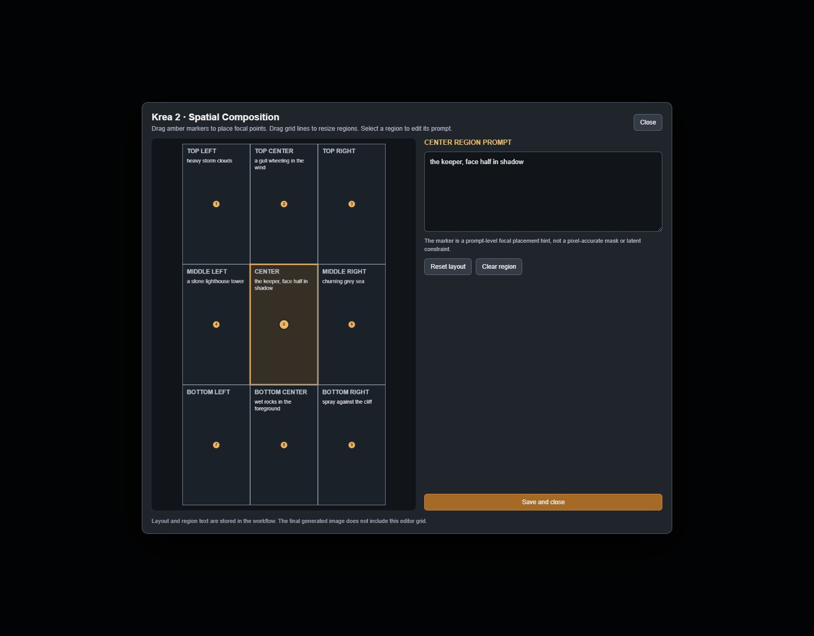

# Krea2 Spatial Composition 3x3

A ComfyUI custom node that turns a 3×3 grid of region descriptions into a single structured
prompt, with an in-app visual editor for placing focal points and resizing regions.

Built for **[Krea 2](https://krea.ai)** portrait workflows, but the output is plain text — it
works with any text-to-image model that responds to positional language.



---

## What it actually does

Nine text boxes, one per grid region, plus an optional base prompt. Non-empty regions are
compiled into one sentence that names the region, its proportional area, its focal point, and
your description. That composed string is what goes to your prompt node.

Given this:

| Region | Text |
|---|---|
| base prompt | `cinematic portrait of a lone lighthouse keeper, overcast light, 85mm` |
| Top-left | `heavy storm clouds` |
| Top-center | `a gull wheeling in the wind` |
| Middle-left | `a stone lighthouse tower` |
| Center | `the keeper, face half in shadow` |
| Middle-right | `churning grey sea` |
| Bottom-center | `wet rocks in the foreground` |
| Bottom-right | `spray against the cliff` |

It outputs:

> cinematic portrait of a lone lighthouse keeper, overcast light, 85mm
>
> Spatial composition map for a portrait frame. Keep the following subjects within their
> specified regions and preserve their relative visual hierarchy: Top-left region (x 0-33%,
> y 0-33%), focal placement at (17% from left, 17% from top): heavy storm clouds; Top-center
> region (x 33-67%, y 0-33%), focal placement at (50% from left, 17% from top): a gull wheeling
> in the wind; Middle-left region (x 0-33%, y 33-67%), focal placement at (17% from left, 50%
> from top): a stone lighthouse tower; Center region (x 33-67%, y 33-67%), focal placement at
> (50% from left, 50% from top): the keeper, face half in shadow; Middle-right region (x 67-100%,
> y 33-67%), focal placement at (83% from left, 50% from top): churning grey sea; Bottom-center
> region (x 33-67%, y 67-100%), focal placement at (50% from left, 83% from top): wet rocks in
> the foreground; Bottom-right region (x 67-100%, y 67-100%), focal placement at (83% from left,
> 83% from top): spray against the cliff.

Empty regions are skipped entirely — they add no text.

## What it does not do

This is **prompt-level guidance only**. It does not create masks, per-region latent
conditioning, ControlNet hints, or any guarantee that a subject lands where you asked. The
composed geometry is natural language; the model is free to ignore it, and at low guidance or
with heavily LoRA-adapted models it often partly will.

If you need deterministic placement, this node is the wrong tool — look at regional prompting
or masking nodes instead.

---

## Requirements

| | |
|---|---|
| ComfyUI | 0.36.0 or newer (uses the current `app.registerExtension` frontend API) |
| Node-side Python deps | `torch`, `numpy`, `Pillow` — all already present in ComfyUI |

No extra Python packages to install.

### The bundled example workflow has external dependencies

`Krea2.V1a_with_SpatialComposition.json` is a full working Krea 2 pipeline, not just this node.
It needs all of the following, or ComfyUI will report missing nodes on load:

- **Core ComfyUI** — `UNETLoader`, `CLIPLoader`, `VAELoader`, `EmptyLatentImage`, `VAEDecode`, `ConditioningZeroOut`
- **Krea2-specific** — `Krea2PromptWeight`, `ConditioningKrea2Rebalance`. These are not shipped in this repo; they come from your ComfyUI build or a Krea 2 node pack. Check ComfyUI's missing-node dialog for the exact source.
- **[ClownsharKSampler](https://github.com/ClownsharkBatwing/RES4LYF)** — `ClownsharKSampler_Beta`
- **[ComfyUI-Lora-Manager](https://github.com/willmiao/ComfyUI-Lora-Manager)** — `Prompt`, `Lora Loader`, `Save Image`, `TriggerWord Toggle`
- **[rgthree-comfy](https://github.com/rgthree/rgthree-comfy)** — `Image Comparer`
- **ComfyMath** — `ComfyMathExpression`
- `SeedGenerator`

The **node itself** only needs core ComfyUI. If you just want to try it, add the node to any
existing workflow and skip the example.

### Models used by the example

These are the author's choices, not requirements — substitute your own Krea 2 files:

| Slot | File |
|---|---|
| UNET | `Krea2/krea2Cyberrealistic_v40_bf16.safetensors` |
| CLIP | `Huihui-Qwen3-VL-4B-Instruct-abliterated-fp8_scaled.safetensors` (type `krea2`) |
| VAE | `qwen_image_vae.safetensors` |
| Latent | 1152 × 2048 |

---

## Install

### ComfyUI Manager

Search for **Krea2 Spatial Composition 3x3** in *Manager → Custom Nodes Manager*, install, then
restart ComfyUI.

### comfy-cli

```bash
comfy node install krea2-spatial-composition
```

### Manual

```bash
cd ComfyUI/custom_nodes
git clone https://github.com/un4ssociated/Krea2SpatialComposition.git
```

Restart ComfyUI **completely**. The node is `Krea2 Spatial Composition 3x3 — Visual Editor`
under the `Krea2/Composition` category.

If the node appears but **Open 3×3 Visual Editor** does nothing, the frontend extension failed to
load — hard-refresh the browser tab (Ctrl+Shift+R) and check the browser console for errors from
`web/spatial_editor.js`.

## Update

Manager and `comfy-cli` pick up new versions from the
[Comfy Registry](https://registry.comfy.org). A manual install updates with `git pull` in the
node folder, followed by a ComfyUI restart.

---

## Use

1. Add the node to your graph.
2. Click **Open 3×3 Visual Editor**.
3. Click a region on the grid to select it, then type its description in the panel.
4. Drag an amber numbered marker to set that region's focal placement.
5. Drag a vertical or horizontal divider to resize columns and rows.
6. **Save and close** when done.

The base scene description belongs in your prompt node upstream, not in this one — this node's
`base_prompt` is for scene text you want to keep next to the region map.

**Escape** closes the editor. Escape while typing first leaves the text field, so a double-tap
will not discard your work mid-sentence.

Everything you type is written to the node's widgets live, so the layout and all nine texts are
stored in the workflow JSON. Nothing is lost if you close the editor without saving.

### Editor controls

| Action | Result |
|---|---|
| Click a region | Select it and load its text |
| Drag a marker | Move that region's focal point, clamped inside its own cell |
| Drag a divider | Resize the row or column, keeping a 0.08 minimum gap |
| **Reset layout** | Restore equal thirds and centred markers |
| **Clear region** | Empty the selected region's text |
| **Save and close** / Escape / click backdrop | Commit and close |

---

## Node reference

### Inputs

| Input | Type | Default | Notes |
|---|---|---|---|
| `base_prompt` | STRING | `""` | Prepended verbatim, separated by a blank line. |
| `top_left` … `bottom_right` | STRING ×9 | `""` | Region descriptions. Empty ones are skipped. |
| `layout_json` | STRING | see below | Region geometry, written by the editor. |
| `canvas_width` | INT | `1152` | Used for the layout guide image only. |
| `canvas_height` | INT | `2048` | Used for the layout guide image only. |

`layout_json` holds:

```json
{
  "x": [0.333, 0.667],
  "y": [0.333, 0.667],
  "anchors": [[0.167, 0.167], [0.5, 0.167], "...9 total"]
}
```

`x` and `y` are the two divider positions; `anchors` is one `[x, y]` per cell in row-major order.
Dividers are clamped to 0.08–0.92 and held at least 0.08 apart, so a malformed or hand-edited
value can't collapse a region to zero size. Invalid JSON logs a warning and falls back to equal
thirds rather than failing the run.

### Outputs

| Output | Type | Notes |
|---|---|---|
| `prompt` | STRING | The composed prompt. |
| `layout_guide` | IMAGE | Optional visualization of regions and markers. |

`layout_guide` is for inspection only — wire it to **Preview Image** if you want to see it. It is
not part of the generation path, and the generated image never contains the grid.

---

## Limitations

- **The guide image is capped.** It renders at most 1024 × 1536 and at least 384 px per side, so extreme aspect ratios distort the preview. The prompt text is unaffected — it always uses the true percentages.
- **`canvas_width` / `canvas_height` do not set your generation resolution.** Set `EmptyLatentImage` (or equivalent) yourself. They only shape the guide.
- **Nine regions is fixed.** This is a 3×3 grid, not a configurable one.
- **Unused regions cost nothing but also contribute nothing.** There is no "auto-fill" — a blank region simply isn't mentioned, and the model is free to put anything there.
- The text is sent to the model raw. Aggressive prompt-weighting nodes downstream may distort the region clauses more than the base prompt.

## Tips

- Describe **what is in** a region, not where it should go — the node already states the position. `a gull` beats `a gull in the top middle`.
- Long descriptions dilute the positional clause. Two to eight words per region works best.
- If subjects ignore their regions, reduce LoRA strength or raise CFG before adding more text.
- Leave regions empty on purpose. A mostly-empty grid gives the model room, and often composes better than nine crowded cells.

## License

MIT. See [LICENSE](LICENSE).

## Credits

- Built for ComfyUI by [un4ssociated](https://github.com/un4ssociated).
